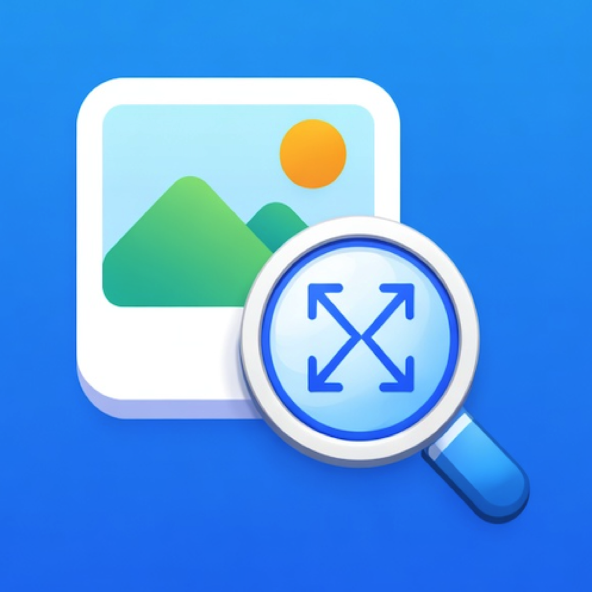
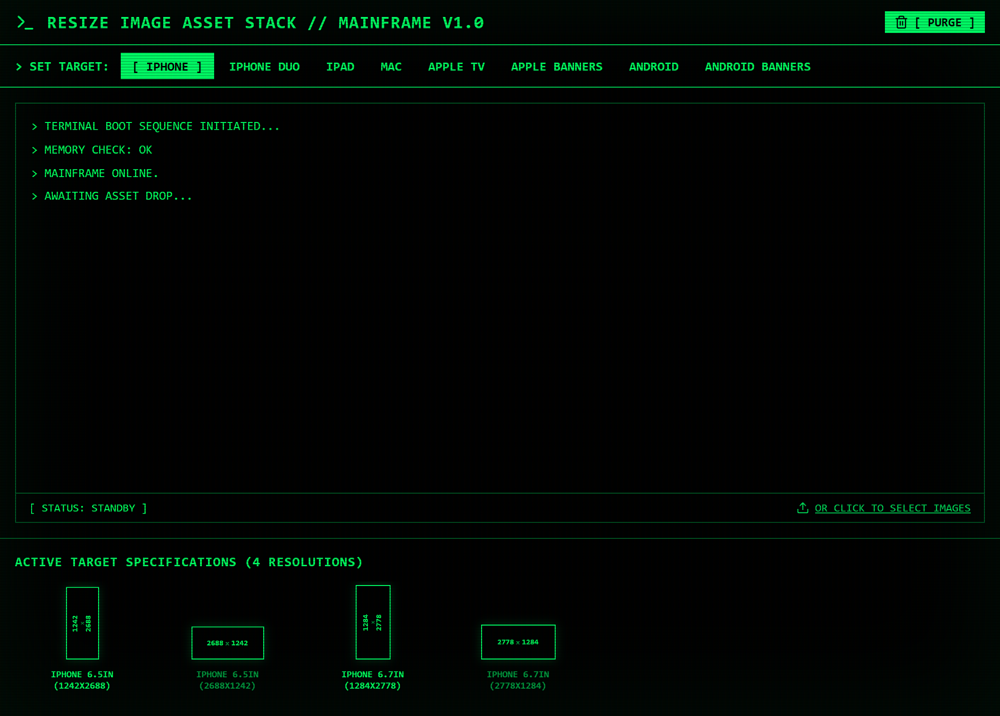

<p align="center">
  
</p>

<p align="center">
  
  
  
  
  
</p>

# Resize Image Asset Stack // Mainframe V1.0

A retro-styled, high-performance desktop and web utility built with **Tauri + React/Vite** to automate the most tedious parts of app store asset delivery: prepping, padding, and resizing **App Store & Google Play screenshots**.

Resize Image Asset Stack features a sleek, purely `monospaced` CRT terminal aesthetic with live phosphor green console logs, reactive target visualizers, and an intelligent aspect-fill background blur engine.

<p align="center">
  
</p>

---

## 🖲️ Features

- **Cross-Platform Power:** Runs natively on macOS, Windows, and Linux via Tauri, and also runs directly in modern web browsers.
- **Bulk Processing:** Drop single files, batches of screenshots, or entire image queues into the terminal drop zone.
- **Intelligent Edge-Bleed Blur:** The rendering engine pads aspect mismatches using an aspect-fill blurred background with edge-bleed protection and contrast tinting, keeping screenshots crisp without awkward borders.
- **Smart-Fill vs Fit:** If your source image closely matches the destination aspect ratio, it automatically fills seamlessly to prevent black slivers; otherwise, it fits sharply centered against the blurred canvas.
- **Pixel-Perfect Exact Targets:**
  - **iPhone 6.5-inch:** `1242 × 2688px` & `2688 × 1242px`
  - **iPhone 6.7-inch:** `1284 × 2778px` & `2778 × 1284px`
  - **iPhone Duo:** `1398 × 2034px`, `2034 × 1398px`, `2007 × 2853px`, `2853 × 2007px`
  - **iPad 12.9-inch:** `2048 × 2732px` & `2732 × 2048px`
  - **iPad 13-inch:** `2064 × 2752px` & `2752 × 2064px`
  - **Mac Displays:** `1280 × 800px`, `1440 × 900px`, `2560 × 1600px`, `2880 × 1800px`
  - **Apple TV:** `1080p` (`1920 × 1080px`) & `4K` (`3840 × 2160px`)
  - **Apple Banners & Creatives:** `5244 × 2950px`, `3840 × 1646px`, `3840 × 2560px`, `1920 × 1280px`
  - **Android Phone Screenshots:** `1080 × 1920px`, `1920 × 1080px`, `1440 × 2560px`, `2560 × 1440px`, `2160 × 3840px`, `3840 × 2160px`
  - **Android Banners (Google Play):** `Feature Graphic (1024 × 500px)`, `TV Banner (1280 × 720px)`
- **Zero-Friction Terminal UI:** Watch background crunching unfold in retro monochrome phosphor output, complete with an interactive resolution visualizer row and instant folder export controls.
- **Dual Export Pipeline:**
  - **Tauri Desktop Mode:** Prompts for native folder selection and writes files directly into structured subdirectories (`[OPEN EXPORT]` opens in your system file explorer).
  - **Web Browser Mode:** Automatically bundles rendered folders and assets into a structured downloadable ZIP archive.

---

## 🚀 Getting Started

For an in-depth command reference and architecture workflow, see [GETTING_STARTED.md](GETTING_STARTED.md).

### Prerequisites
- [Node.js](https://nodejs.org/) (v18+)
- [Rust & Cargo](https://www.rust-lang.org/tools/install) (required for building the desktop Tauri binary; optional for web dev)

### Installation
```bash
# Clone the repository
git clone https://github.com/codejourneysoftware/ResizeImageAssetStack.git
cd ResizeImageAssetStack

# Install dependencies
npm install
```

### Running in Development
```bash
# Run web client with hot-module reloading:
npm run dev

# Or launch the native Tauri desktop app:
npm run tauri dev
```

### Building for Production
```bash
# Build web distribution:
npm run build

# Package desktop installer / binary:
npm run tauri build
```

---

## 🕹️ Architecture

- **Frontend:** React 19 + TypeScript + Vite 6
- **Desktop Runtime:** Tauri 2.0 (Rust backend with native folder dialogs, direct disk I/O, and file explorer integration)
- **Image Pipeline:** HTML5 Canvas / OffscreenCanvas Gaussian Blur pipeline with bleed padding and smart aspect ratio matching
- **Archive Engine:** JSZip for structured multi-folder export in web environments

---

## 📄 License

This project is licensed under the GNU General Public License v3.0 (GPL-3.0). See [LICENSE](LICENSE) for details.
